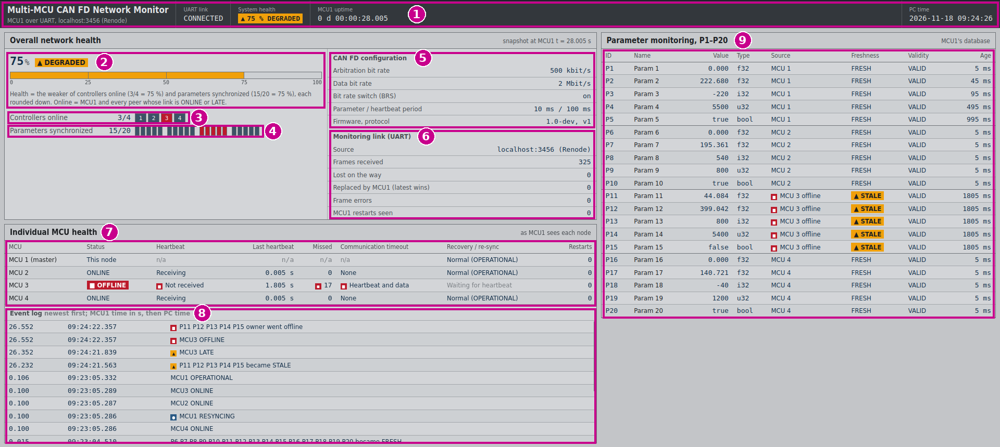
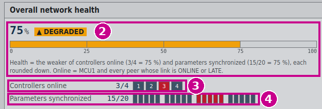

<div class="title">
<h1 class="doc-title">Multi-MCU CAN FD Communication and Monitoring:<br>Technical Document</h1>
<p class="author">Het Patel</p>
<p class="affil">Embedded Firmware Engineering Assignment, Noccarc Robotics Pvt. Ltd.<br>
Repository: github.com/deadhet/Multi-MCU-CAN-FD-Communication</p>
</div>

<p class="abstract"><b><i>Abstract</i>—Four STM32H743VIT6 controllers share 20 parameters over one CAN FD bus (500 kbit/s arbitration, 2 Mbit/s data). Each controller owns five parameters, sends them every 10 ms in a 32-byte frame protected by a CRC-16 that covers the CAN identifier, and keeps a validated copy of all 20 with their validity and freshness. Heartbeats every 100 ms let every node detect, on its own, a peer that is late (150 ms), offline (350 ms), restarted or recovered. The master, MCU1, reports its database and the network health over a UART link (Protobuf, COBS, CRC-16) to a Python web dashboard. The bare-metal firmware runs as four images in Renode 1.17.0. All six assignment stages are implemented and verified by host unit tests, scripted fault scenarios, an end-to-end check of the UART link and deliberate break tests. This document describes the architecture, the main design decisions, the results and the limits of the simulation.</b></p>

<p class="keywords"><b><i>Index Terms</i>—CAN FD, STM32H743, Renode, heartbeat, fault detection, recovery, Protobuf, COBS.</b></p>

## I. Introduction

The assignment asks for four microcontrollers that exchange parameters over CAN FD, keep a synchronised parameter database, detect missing, restarted and recovered controllers, and report everything to a monitoring application, with the whole system developed and tested in Renode. All six suggested stages are complete: four-node CAN FD communication, parameter ownership and database synchronisation, heartbeat monitoring and fault detection, recovery and re-synchronisation, Renode system-level testing, and the UART interface with the Python dashboard (evidence in Table XI).

Section II describes the architecture, Sections III–V the CAN protocol, the parameter database and the health handling, Sections VI–VIII the UART link, the dashboard and the debug log. Section IX lists the main design decisions, Section X the results, Section XI the limits of the simulation and Section XII the future scope. Paths are relative to the repository root; the per-module documents in `docs/` give the full detail.

## II. System Architecture

### A. Network

All four controllers are equal nodes on one CAN FD bus. Each owns five parameters and keeps a copy of all 20. MCU1 is the master because it monitors the network and reports to the PC, not because it relays data: the slaves exchange data directly and keep doing so when MCU1 fails.

```
           CAN FD bus (Renode CAN hub): 500 kbit/s arbitration, 2 Mbit/s data, BRS on
    ┌────────────────────┬────────────────────┬────────────────────┬────────────────────┐
  MCU1 (master)        MCU2                 MCU3                 MCU4
  owns P1–P5           owns P6–P10          owns P11–P15         owns P16–P20
    │ USART3, 230,400 baud: SNAPSHOT, EVENT, CONFIG frames
    ▼
  PC: Python dashboard (http://127.0.0.1:8765)        every MCU: USART1 debug log → logs/mcuN.log
```
<p class="fcap">Fig. 1. System overview.</p>

### B. Firmware structure

The firmware is bare-metal C for the STM32H743VIT6 (480 MHz Cortex-M7), with no RTOS and no dynamic memory. All nodes build from the same sources; only the main file differs (`app_master.c` for MCU1, `app_slave.c` for MCU2–MCU4) and the node number is a build define.

```
  App        nodes/master/app_master.c, nodes/slave/app_slave.c: task table, main loop,
             carries results between the services
  Scheduler  sched/: runs each task when its period has passed; measures run time and lateness
  Services   comm/    CAN frame format: pack, CRC, sequence, checks 1–7
             params/  database of P1–P20: check 8, validity, freshness, settle rule
             diag/    link state of every peer, own state, restarts, recovery
             monitor/ SNAPSHOT, EVENT and CONFIG frames for the PC (MCU1 only)
  Drivers    drivers/: clocks, 1 ms SysTick, FDCAN1 with 4 RAM receive queues,
             USART1 debug ring, USART3 link with latest-wins slots and an event queue
  Start-up   startup/, linker/: reset handler, .data and .bss, memory map
```
<p class="fcap">Fig. 2. Firmware layers (paths under <code>firmware/common/</code> unless shown).</p>

One rule shapes the code: **calls only go downward, and services never call each other.** When `diag/` finds that a peer went offline it does not tell `comm/` or `params/`; it returns the result, and the application calls `comm_forget_peer()` and `params_set_owner_offline()`. Each service is plain C with no register access, so the host tests compile and run it on a PC.

Memory, from `arm-none-eabi-size`: MCU1 uses 21.8 KB of flash and 13.7 KB of RAM (6.6 KB of it the UART buffers, placed in AXI SRAM where a DMA can reach them); each slave uses 13.8 KB of flash and 6.0 KB of RAM.

### C. Execution model

After start-up every node runs one loop that never waits:

```
for (;;) {
    sched_pass_mark();            // longest-pass measurement
    sched_run_due();              // the task table, top to bottom
    look_for_events(false);       // MCU1 only: an EVENT frame if a state changed
    while (comm_receive(&frame)) {          // empty the CAN receive queues
        parameter block → params_apply_block() + diag_on_param_block()
        heartbeat       → diag_on_heartbeat()
        look_for_events(false);   // MCU1 only
    }
}
```

<p class="tcap">TABLE I<br><span class="sc">Task Table</span></p>

| Task | Period | First run | Nodes | Job |
|---|---|---|---|---|
| `param` | 10 ms | 10 ms | all | Sample own sensors, send the parameter block |
| `fresh` | 5 ms | 5 ms | all | Freshness of all 20 parameters |
| `diag` | 5 ms | 5 ms | all | Heartbeat timeouts, link states, own state |
| `hb` | 100 ms | 0 ms | all | Send the heartbeat |
| `report` | 1 s | 5 ms | all | Debug report over USART1 |
| `snap` | 100 ms | 5 ms | MCU1 | SNAPSHOT to the PC |
| `cfg` | 1 s | 0 ms | MCU1 | CONFIG to the PC |

A task is due when `now − last_run ≥ period`; unsigned subtraction keeps this right when the millisecond counter wraps after 49.7 days. A task that cannot do its job, for example because a buffer is full, counts the failure and returns. Interrupts do only the time-critical work: FDCAN (highest priority) copies and timestamps received frames, SysTick counts milliseconds, and the two USART interrupts move bytes out of their buffers.

### D. Data paths

```
 sending node                                   every receiving node
 param_task, every 10 ms                        FDCAN1 interrupt
  ├ sample own sensors, check 8 on each value    ├ hardware filter → Rx FIFO 0 (16 frames)
  ├ build the block: 5 values + status bits      ├ copy the frame, stamp its arrival time
  └ comm: version, source, sequence, CRC-16      └ RAM queue: heartbeats | one per peer (8 each)
     fdcan_send() → Tx FIFO (4) ──── CAN FD ───►  main loop: comm_receive(), checks 1–7
                                                   ├ block     → params: check 8, settle rule
                                                   └ heartbeat → diag: link state, restart
                                                 every 5 ms: params freshness (STALE after 30 ms)
                                                             diag timeouts (LATE 150, OFFLINE 350 ms)
                                                 MCU1: view → EVENT / SNAPSHOT / CONFIG → USART3
```
<p class="fcap">Fig. 3. Path of a parameter value, from its owner to every other node and to the PC.</p>

## III. CAN FD Communication

### A. Bus configuration and identifiers

FDCAN1 runs from an 80 MHz kernel clock with a prescaler of 2 (25 ns per time quantum). The nominal phase uses 80 quanta (500 kbit/s, sample point 80 %), the data phase 20 quanta (2 Mbit/s, sample point 75 %), with transmitter delay compensation at the data sample point. All frames are CAN FD with bit rate switching and 11-bit identifiers.

<p class="tcap">TABLE II<br><span class="sc">Identifier Allocation: ID = (type &lt;&lt; 4) | node</span></p>

| Message | Type | IDs (MCU1–MCU4) | Payload | Period |
|---|---|---|---|---|
| Parameter block | 2 | `0x021`–`0x024` | 32 bytes | 10 ms |
| Heartbeat | 3 | `0x031`–`0x034` | 16 bytes | 100 ms |
| Resynchronisation request (reserved) | 1 | `0x011`–`0x014` | — | not used; rejected by the filters |

The low four bits always name the sender, so no two nodes ever send the same identifier, which CAN arbitration requires. The type sets the priority: parameter blocks win over heartbeats, because the heartbeat is the slowest message and can afford the wait (worst case about 1.9 ms). The hardware filters accept exactly these two ranges, and the same range list routes each frame to its RAM queue.

### B. Frame layouts and samples

Every field is written byte by byte, little-endian; C structures are never copied onto the wire.

<div class="keep" markdown="1">

<p class="tcap">TABLE III<br><span class="sc">Frame Layouts</span></p>

| Bytes | Parameter block (32 bytes) | Bytes | Heartbeat (16 bytes) |
|---|---|---|---|
| 0 | Protocol version (1) | 0 | Protocol version (1) |
| 1 | Source node | 1 | Source node |
| 2–3 | Status: 2 bits per value (OK, SOURCE_STALE, SOURCE_FAULT) | 2 | Node state (BOOT, RESYNCING, OPERATIONAL) |
| 4–7 | Sequence, uint32 | 3 | Parameters synchronised at the sender (0–20) |
| 8–27 | Five values, 4 bytes each, typed by the parameter table | 4–7 | Sequence, uint32 |
| 28–29 | CRC-16 | 8–11 | Uptime in ms, uint32 |
| 30–31 | Padding (the next CAN FD size above 30 is 32) | 12–13 | Error summary (sum of error counters) |
| | | 14–15 | CRC-16 |

</div>

**Sample parameter block**: MCU3, ID `0x023`, sequence 100, sent at t = 1000 ms in scenario S1. The bytes are rebuilt from the values MCU3 logged in its report at t = 1005 ms, with the firmware's layout and CRC:

```
01 03 00 00 64 00 00 00 B2 01 DC B6 1D 13 C3 43 26 FD FF FF 2C 01 00 00 00 00 00 00 BB F5 00 00
```

| Bytes | Field | Value |
|---|---|---|
| `01` `03` | Version, source | 1, MCU3 |
| `00 00` | Status | all five values OK |
| `64 00 00 00` | Sequence | 100 (one block every 10 ms since t = 10 ms) |
| `B2 01 DC B6` | P11, float32 | −6.6 × 10⁻⁶ (a sine at its zero crossing) |
| `1D 13 C3 43` | P12, float32 | 390.149 |
| `26 FD FF FF` | P13, int32 | −730 |
| `2C 01 00 00` | P14, uint32 | 300 |
| `00 00 00 00` | P15, bool | false |
| `BB F5` | CRC-16 | 0xF5BB, over `23 00` (the ID) and bytes 0–27 |
| `00 00` | Padding | |

**Sample heartbeat**: MCU3, ID `0x033`, sequence 11, sent at t = 1000 ms:

```
01 03 02 14 0B 00 00 00 E8 03 00 00 00 00 21 C2
```

Version 1, source MCU3, state 2 (OPERATIONAL), 20 parameters synchronised, sequence 11, uptime 1000 ms (`E8 03 00 00`), error summary 0, CRC 0xC221 over `33 00` and bytes 0–13.

**CRC.** CRC-16/CCITT-FALSE (polynomial 0x1021, initial value 0xFFFF), computed over the CAN identifier (two bytes, not sent) and every payload byte before the CRC. Each node checks the routine against its known answer (`"123456789"` → 0x29B1) before it starts CAN. The CAN controller's own CRC protects only the wire; this one also catches corruption inside a node (controller, message RAM, receive queues) and a valid payload under the wrong identifier. The approach follows the black-channel principle of IEC 61784-3 [3]: the transport is untrusted and the end points check the data.

### C. Validation

The main loop checks every received frame, cheapest check first, and stops at the first failure. A rejected frame is counted by reason, logged at most once a second per reason, and dropped: for the rest of the system it never arrived.

<p class="tcap">TABLE IV<br><span class="sc">Receive Checks</span></p>

| # | Check | Counter on failure |
|---|---|---|
| 1 | Known type, sender 1–4, not this node's own ID | `bad_id`, `duplicate_node` |
| 2 | CAN FD frame with bit rate switching | `bad_format` |
| 3 | Length 32 (block) or 16 (heartbeat) | `bad_length` |
| 4 | Protocol version 1 | `bad_version` |
| 5 | Source byte equals the sender in the ID | `bad_source` |
| 6 | CRC-16 | `bad_crc` |
| 7 | Sequence newer than the last one accepted; a gap is accepted and counted | `duplicate`, `old_seq`, `lost_frames` |
| 8 | Each value (in `params/`): finite float, bool 0 or 1, within range, owner status not FAULT | value INVALID, last good value kept |

**Restart rule.** A heartbeat whose sequence went back, and which reports BOOT or a lower uptime, comes from a node that restarted: its streams are forgotten, a restart is counted and the heartbeat is accepted as a first frame. The CRC is checked before this rule, so a corrupted frame cannot fake a restart.

### D. Buffering, timing and bus load

**Transmit.** `fdcan_send()` writes into the 4-frame hardware Tx FIFO and never waits. If the FIFO is full (the node is off the bus, or nobody acknowledges), the frame is refused and counted, and its sequence number is not used, so a gap seen by a receiver always means a frame lost on the bus.

**Receive.** The hardware Rx FIFO holds 16 frames. The interrupt copies each frame into one of four RAM queues of 8 frames: one for all heartbeats, one per peer for parameter blocks. A full queue overwrites its oldest frame, because the newest data is what matters, and a node that floods the bus can only fill its own queue.

**Bus load** (calculated: Renode's CAN model has no bit timing). A parameter block takes about 207 µs on the bus (247 µs worst case with stuffing), a heartbeat about 140 µs (165 µs). Four nodes sending a block every 10 ms and a heartbeat every 100 ms load the bus to about 10.5 % in the worst case, against a 30 % ceiling. The heartbeat's worst-case delay is about 1.9 ms: one frame already on the bus, four parameter blocks, three higher-priority heartbeats and itself.

## IV. Parameter Ownership and Synchronisation

Every node uses the same five-slot layout, so each parameter type and each sample period runs on all four nodes. The sensors are simulated: two sine waves, two ramps and a toggling flag.

<p class="tcap">TABLE V<br><span class="sc">Parameter Ownership</span></p>

| Slot | MCU1 | MCU2 | MCU3 | MCU4 | Type | Sample period |
|---|---|---|---|---|---|---|
| 1 | P1 | P6 | P11 | P16 | float32 | 10 ms |
| 2 | P2 | P7 | P12 | P17 | float32 | 50 ms |
| 3 | P3 | P8 | P13 | P18 | int32 | 100 ms |
| 4 | P4 | P9 | P14 | P19 | uint32 | 500 ms |
| 5 | P5 | P10 | P15 | P20 | bool | 1000 ms |

The block goes out every 10 ms whatever the sample periods; a slowly sampled parameter repeats its last value with its status. Each node's database holds, per parameter: value, owner, type, validity (NEVER_RECEIVED, VALID, INVALID), freshness (FRESH, STALE), last sequence, age, the owner's source status and an owner-offline flag. The rules:

- **One writer per value.** Only the owner samples a parameter; the others only copy it from accepted frames.
- **A bad value never overwrites a good one.** A value that fails check 8, or that its owner reports as SOURCE_FAULT, becomes INVALID and the last good value is kept.
- **Freshness.** Every 5 ms each age is compared with its limit. A received parameter is STALE after 30 ms without an update, three periods, so two lost frames in a row are tolerated. An own parameter is STALE when its sample is older than three times its sample period, and is then sent as SOURCE_STALE.
- **Synchronised** means VALID and FRESH. MCU1 reports the count in every snapshot; every node sends its own count in its heartbeat.
- **Settle rule.** When a node loses the bus, up to four frames stay in its Tx FIFO. At reconnect they go out first, back to back, with values from before the outage, and they pass every check. So after a sender was silent for more than 30 ms, its parameters stay STALE until one of its blocks arrives 5–30 ms after the previous one, which can only have been sampled after the reconnect. In the reconnect test MCU1 held exactly the three old blocks and turned P11–P15 FRESH only on the next one.
- **Owner offline.** When `diag/` marks a node OFFLINE, its five parameters keep their last value, stay STALE and carry the owner-offline flag. The dashboard shows them as "MCU *n* offline", never as live.
- **Re-synchronisation** needs no request message: the owner's periodic blocks restore its parameters within one period once it is back (FRESH 21–25 ms after a restart in S2 and S4).

## V. Heartbeat, Fault Detection and Recovery

Every node sends a 16-byte heartbeat every 100 ms (Table III). Parameter blocks answer "is this data current?"; heartbeats answer "is this node alive, and in what state?". Watching both lets a node tell a dead peer (both stop) from a live peer whose data path is broken (heartbeats only) or whose heartbeat path is broken (data only). Every node runs the same health logic on its peers, so each one detects a failure by itself; MCU1 additionally reports what it sees.

<p class="tcap">TABLE VI<br><span class="sc">Link State of a Peer, as Seen by Each Node</span></p>

| State | Entered when |
|---|---|
| UNKNOWN | Never heard (becomes OFFLINE 350 ms after boot) |
| ONLINE | A heartbeat is received |
| LATE | 150 ms without a heartbeat (1 missed) |
| OFFLINE | 350 ms without a heartbeat (3 missed) and its data not arriving either |
| NO_HEARTBEAT | 350 ms without a heartbeat, but its parameters still arrive VALID and FRESH |
| DATA_INVALID | Heartbeats arrive, but no parameter block passed the checks for 350 ms |
| RECOVERING | The first heartbeat after OFFLINE, or a restart |
| ONLINE (recovered) | A later heartbeat that reports OPERATIONAL |

**Timeouts and their reasons.** LATE at 1.5 heartbeat periods absorbs the ≈1.9 ms worst-case delay, so a single late heartbeat never looks like a failure. OFFLINE after three missed heartbeats tolerates two lost frames. The missed count rises at 150 ms and then once per 100 ms. There is no retransmission at the application level: the CAN controller already retries a frame that failed on the wire, and a lost periodic frame is simply replaced by the next one 10 ms or 100 ms later.

**Recovery.** A node that comes back is not trusted at once. Its first heartbeat only makes it RECOVERING, because that frame can be an old one from its Tx FIFO; recovery is confirmed by a later heartbeat that reports OPERATIONAL, about 100 ms later. Scenario S3 shows why: MCU3's heartbeat 51, queued at 5.000 s just as it lost the bus, was the first one the others received at 15.000 s, ten seconds old and still saying OPERATIONAL. A restart is detected by the restart rule while the peer is tracked, and by the uptime going back after it was OFFLINE (wrap-safe across the 49.7-day counter wrap).

**Own state.** A node starts in BOOT, moves to RESYNCING when it hears the first heartbeat from any node, and to OPERATIONAL once every connected peer has sent it an accepted parameter block. If no peer is left it returns to RESYNCING: a node alone never claims OPERATIONAL.

<p class="tcap">TABLE VII<br><span class="sc">Measured Detection and Recovery Times (Renode)</span></p>

| Event | S2: MCU3 halted at 5 s, reset at 10 s (seen by MCU1) | S3: MCU3 off the bus 5–15 s (seen by MCU1) | S4: MCU1 halted at 5 s, reset at 10 s (seen by MCU2) |
|---|---|---|---|
| Parameters STALE | 5.021 s | 5.022 s | 5.025 s |
| LATE | 5.051 s | 5.052 s | 5.050 s |
| OFFLINE, owner-offline flag | 5.251 s | 5.252 s | 5.250 s |
| RESTART | 10.000 s | (no restart) | 10.000 s |
| RECOVERING | 10.000 s | 15.000 s | 10.000 s |
| Parameters FRESH | 10.021 s | 15.012 s | 10.025 s |
| ONLINE (recovered) | 10.100 s | 15.100 s | 10.100 s |

The failed node's last heartbeat left at 4.900 s, so LATE and OFFLINE came 150 ms and 350 ms after it, within the 1 ms of the 5 ms check and of the nodes' clock offsets. Throughout, the remaining nodes stayed OPERATIONAL and kept exchanging their parameters. In S3 the disconnected MCU3 saw all three peers OFFLINE at 5.250 s and dropped to RESYNCING itself; in S4 the slaves carried on without the master (there is no failover).

## VI. UART Monitoring Link

### A. Link and frame

MCU1 sends on USART3 (TX on PD8) at 230,400 baud, 8N1, without flow control; the link is one-way. In Renode USART3 is a TCP socket (port 3456); on a board it would be a USB-UART adapter. Each frame is

```
[version << 4 | type] [sequence, uint32 LE] [Protobuf payload] [CRC-16 LE]   →  COBS  →  0x00
```

The payload schema is `proto/monitor.proto`: nanopb generates fixed-size C structures for MCU1 (no `malloc`, maximum sizes known at compile time) and the dashboard's Python code comes from the same file. The CRC is the CAN function. COBS [4] removes every 0x00 from the frame, so 0x00 only marks the end of a frame and a receiver is back in step at the next 0x00 after any error.

<p class="tcap">TABLE VIII<br><span class="sc">UART Messages</span></p>

| Type | Message | Sent | On the wire | Content |
|---|---|---|---|---|
| 1 | SNAPSHOT | Every 100 ms | 451–454 B measured (1,059 B maximum) | Uptime, health, 4 nodes, all 20 parameters, frames skipped |
| 2 | EVENT | On every change | 14–20 B measured (25 B maximum) | Time and one change, with a bit mask of the nodes or parameters |
| 3 | CONFIG | At start-up, then every 1 s | ≈400 B | Bit rates, BRS, periods, versions, parameter names |

The link carries about 4,900 B/s, 21 % of its capacity.

**Sample USART3 frame**: EVENT, sequence 5, "MCU3 went OFFLINE" at 1005 ms, as written by the C encoder in the host test (`firmware/tests/host/test_monitor.c`). 18 bytes on the wire:

<div class="keep" markdown="1">

```
03 12 05 01 01 0C 08 ED 07 1A 04 08 04 10 03 E4 B0 00
COBS-decoded:  12 | 05 00 00 00 | 08 ED 07 1A 04 08 04 10 03 | E4 B0
```

| Bytes (decoded) | Field | Value |
|---|---|---|
| `12` `05 00 00 00` | Header; sequence | version 1, type 2 (EVENT); sequence 5 |
| `08 ED 07` | `Event.time_ms` (field 1, varint) | 1005 ms |
| `1A 04` `08 04` `10 03` | `Event.node` (field 3, 4 bytes): `nodes`, `link` | bit mask 0b0100 = MCU3; link 3 = OFFLINE |
| `E4 B0` | CRC-16 | 0xB0E4 over the 14 bytes before it; on the wire a final `00` ends the frame |

</div>

On the wire, COBS code `03` stands for two data bytes and a zero, the two `01` codes for two more zeros, and `0C` for the last eleven bytes.

### B. Transmit side (MCU1)

- **MCU1 never waits for the link.** The main loop writes each frame into a buffer and hands it over; the USART3 transmit interrupt sends it one byte at a time (Renode's USART has no transmit DMA request; the buffers already sit in DMA-reachable RAM).
- **Latest wins for SNAPSHOT and CONFIG.** Each has two buffers, one on its way out and one for the next frame. A newer snapshot replaces a waiting one, so after a stall the newest state goes out, never a backlog.
- **EVENTs are queued and never replaced** (16 entries). If the queue were full an event would be dropped and counted; the next snapshot still carries the state.
- **One order.** One counter numbers every hand-over, and the interrupt always sends the oldest first, so the stream carries the frames in the order they were made.
- **Every frame gets a sequence number**, also one that is replaced or dropped. Those are counted in the snapshot's `frames_skipped`, so the PC can tell them from frames lost on the way.
- **Events.** `diag/` and `params/` count every state change. MCU1 looks for changes after every task pass and after every received CAN frame, and once more before each snapshot, on the snapshot's own data. Each kind of change becomes one event naming every node or parameter that made it, so even a state that lasts a single millisecond is reported, and the events sent before a snapshot explain it exactly.

### C. PC side

The dashboard checks each frame in order: split at 0x00, COBS, length, CRC, version, type, Protobuf. A frame that fails is counted by reason and never shown. Sequence accounting splits every gap into frames MCU1 replaced and frames lost on the way. The link is CONNECTED while a valid frame arrived within 300 ms (1,500 ms in Renode, which runs at about 0.3× real time), LOST otherwise, and DISCONNECTED without a byte source. A sequence that goes back marks an MCU1 restart; an uptime that goes down while the sequence continues is the 49.7-day wrap, and the dashboard keeps the total uptime.

## VII. Monitoring Dashboard

The dashboard (`dashboard/`) is a Python program that reads the UART link, decodes it and serves a web page at `http://127.0.0.1:8765`, updated five times a second through Server-Sent Events. It needs only the Python standard library plus `protobuf` and `pyserial`. Every decision (texts, states, colours) is made in Python and covered by tests; the page only draws. The display style follows high-performance HMI practice (ISA-101 [6]): normal states stay plain, and only a fault is coloured: amber for caution, red for a failure.

Fig. 4 was taken during a run in which MCU3 was halted at about 26.2 s; the snapshot shown is from MCU1's t = 28.005 s.

<figure>

<figcaption>Fig. 4. The dashboard with MCU3 halted. The numbered regions are described below.</figcaption>
</figure>

<figure class="zoom">

<figcaption>Fig. 5. Regions 2–4 of Fig. 4 enlarged: the health figure and its two inputs.</figcaption>
</figure>

1. **Header.** The UART link state (CONNECTED), the system health label (75 % DEGRADED), MCU1's uptime from the snapshot and the PC's clock. The label is HEALTHY at 100 %, DEGRADED between 1 and 99 %, DOWN at 0 %, and NO DATA when the link is lost.
2. **Network health** (Fig. 5). Health is the weaker of two numbers, each in whole percent and rounded down: controllers online out of 4 (region 3) and parameters synchronised out of 20 (region 4). Here MCU3 is offline, so 3/4 = 75 %, and its five parameters are stale, so 15/20 = 75 %; health = min(75 %, 75 %) = 75 %. MCU1 computes it and sends it in every snapshot; the page shows it as received, with the formula and both counts written out under the bar. The weaker figure is used rather than the average, because an average would show 50 % for a network in which every controller talks but no data arrives.
3. **Controllers online, 3/4.** One box per MCU; MCU3's is red. A controller counts as online if it is MCU1 itself, or a peer whose link is ONLINE or LATE: one late heartbeat is not yet a failure.
4. **Parameters synchronised, 15/20.** One box per parameter, grouped by owner; P11–P15 are red. A parameter counts if it is VALID and FRESH in MCU1's database.
5. **CAN FD configuration**, from the CONFIG message: 500 kbit/s arbitration, 2 Mbit/s data, BRS on, 10 ms and 100 ms periods, firmware and protocol version.
6. **Monitoring link.** Frames received (325), lost on the way (0), replaced by MCU1 (0), frame errors (0) and MCU1 restarts seen (0): every loss on the link would be visible here.
7. **Individual MCU health**, as MCU1 sees each node: link state, heartbeat reception, time since the last heartbeat, missed heartbeats, communication timeout, recovery and re-synchronisation, restarts. MCU3 is OFFLINE: its last heartbeat was 1.805 s ago, which is 17 missed ones (the first counted at 150 ms, then one per 100 ms: (1805 − 150) / 100 + 1 = 17). The timeout reads "Heartbeat and data", because both streams stopped (with data still arriving it would be NO_HEARTBEAT), and recovery is "Waiting for heartbeat".
8. **Event log**, newest first, with MCU1's time and the PC's time. The halt appears in the order the rules predict: P11–P15 became STALE at 26.232 s (30 ms after MCU3's last block), MCU3 LATE at 26.352 s (150 ms after its last heartbeat), MCU3 OFFLINE and P11–P15 "owner went offline" at 26.552 s (350 ms). The boot sequence is at the bottom: MCU1 RESYNCING at 0.100 s and OPERATIONAL at 0.106 s.
9. **Parameter monitoring, P1–P20**: ID, name, typed value, type, source MCU, freshness, validity and age. P11–P15 show their last received values, amber STALE and red "MCU 3 offline", age 1805 ms; they are still VALID, because those last values passed check 8. Nothing is substituted. The ages of MCU1's own parameters (P2 45 ms, P3 95 ms, P4 495 ms, P5 995 ms) follow their 50, 100, 500 and 1000 ms sample periods.

## VIII. Debug Logging (USART1)

Every node writes a text log on USART1 (115,200 baud), which Renode stores as `logs/mcuN.log`. Text goes into a 2 KB ring that the USART1 interrupt empties; text that does not fit is dropped whole and counted, so the main loop never waits for the log either. Each line starts with the node. There are two kinds of line: one for every state change, with the time in ms, and a report every second. Rejected CAN frames are logged at most once a second per reason.

State changes of MCU1 in scenario S2:

```
MCU1 t=5021 db STALE 11 12 13 14 15
MCU1 t=5051 diag n3 LATE
MCU1 t=5251 diag n3 OFFLINE
MCU1 t=5251 db OWNER_OFFLINE 11 12 13 14 15
MCU1 t=10000 diag n3 RESTART
MCU1 t=10100 diag n3 ONLINE recovered
```

<div class="keep" markdown="1">

MCU1's one-second report at t = 7006 ms in the same run, while MCU3 is halted (the same state as Fig. 4):

<pre class="log">MCU1 t=7006 tx p=700 h=71 nq=0/0
MCU1 rx n2 p=700/700 h=70/71 r=0 n3 p=499/499 h=49/50 r=0 n4 p=700/700 h=70/71 r=0
MCU1 err id=0 dupnode=0 fmt=0 len=0 ver=0 src=0 crc=0 dup=0 old=0 lost=0 ovf=1
MCU1 drv fifo_lost=1 ovw=0/0/0/0 unrouted=0 tx_full=0
MCU1 db synced=15 valid=20 invalid=0 stale=5 never=0 offline=5 rej=0 gap n2=10/10 n3=10/11 n4=10/11 held n2=0 n3=0 n4=0
MCU1 val 1=3054676940 2=1133293881 3=4294966986 4=1300 5=0 6=3063065548 7=1134322290 8=380 9=2600 10=0 11=1075234162 12=1131574941 13=470 14=2700 15=0 16=3071454156 17=1136379109 18=4294967016 19=5200 20=0
MCU1 diag self=OPERATIONAL n2=ONLINE/OPERATIONAL age=6 miss=0 r=0 rec=0 n3=OFFLINE/OPERATIONAL age=2106 miss=20 r=0 rec=0 n4=ONLINE/OPERATIONAL age=6 miss=0 r=0 rec=0
MCU1 sched pass=1011us param=53us/0ms/0 fresh=43us/1ms/1 diag=33us/1ms/1 hb=53us/0ms/0 report=269us/1ms/1 snap=880us/0ms/0 cfg=448us/0ms/0
MCU1 log dropped=0
MCU1 health=75 online=3/4 synced=15/20
MCU1 link sent=94 bytes=34642 snap=71 cfg=8 ev=15 ev_drop=0 ev_peak=1 ev_unflagged=0 skipped=0 enc_err=0 snap_bytes=452/452</pre>

</div>

<p class="tcap">TABLE IX<br><span class="sc">Report Lines</span></p>

| Line | Content (in this sample) |
|---|---|
| `tx` | Blocks and heartbeats sent (700, 71); refused because the Tx FIFO was full (`nq` 0/0) |
| `rx` | Per peer: blocks and heartbeats accepted / sent by it, restarts. MCU3's counts stopped at 499 and 49/50 when it halted |
| `err` | Rejections per check (all 0). `ovf=1` is the one receive-FIFO overflow at boot (Section X-D) |
| `drv` | Driver: hardware FIFO overflows, overwrites per RAM queue, unrouted frames, Tx-full events |
| `db` | Database: synced 15, stale 5, offline 5 (P11–P15); worst arrival gap per peer (10/11 ms); blocks held by the settle rule |
| `val` | Every value as its raw 32 bits, so the logs of different nodes can be compared exactly |
| `diag` | Own state, then per peer: link state / state it last reported, ms since its heartbeat, missed, restarts, recoveries. MCU3: OFFLINE, 2106 ms, 20 missed |
| `sched` | Longest loop pass (1011 µs), then per task: longest run / latest start / late starts |
| `log dropped` | Debug text that did not fit in the 2 KB ring (0) |
| `health` | The same health figure as the snapshot (75 %, 3/4, 15/20) |
| `link` (MCU1) | UART frames and bytes sent, snapshots, configs, events, events dropped, queue peak, frames skipped, snapshot size (452 B) |

The report runs at 1006, 2006, … ms rather than 1005: one start delayed by 1 ms shifted all later runs, as the `sched` line shows (`report=269us/1ms/1`).

## IX. Key Design Decisions

<p class="tcap">TABLE X<br><span class="sc">Main Decisions</span></p>

| Topic | Decision | Reason |
|---|---|---|
| Topology | All nodes equal on the bus; MCU1 monitors and reports, relays nothing | A master failure stops only the reporting; the slaves keep exchanging (S4) |
| Identifiers | <code>(type &lt;&lt; 4) &#124; node</code> | Priority by message type; every sender unique; one filter range per type |
| Data frame | One 32-byte block per node every 10 ms, all five values | One frame, one sequence per node; 10.5 % worst-case bus load; ten times faster than the heartbeat |
| Integrity | Version, source, sequence and a CRC-16 covering the CAN ID | End-to-end checks beyond the CAN CRC (black channel); a bad frame never reaches the database |
| Freshness | STALE after 30 ms (three periods) | Two lost frames are tolerated; a silent node is visible in 30 ms, before it is LATE |
| Health timeouts | LATE at 150 ms, OFFLINE at 350 ms | One lost heartbeat never makes a node OFFLINE; the 1.9 ms worst-case delay is absorbed |
| Partial failures | NO_HEARTBEAT and DATA_INVALID | A broken heartbeat path or data path is not reported as a dead node |
| Recovery | Confirmed by a second heartbeat; settle rule for data | The first frames after a silence can be old ones from the sender's Tx FIFO |
| Receive buffering | Four RAM queues (heartbeats, one per peer), newest kept | After a stall the data is current; a flooding node fills only its own queue |
| Transmit when full | Refuse, count, keep the sequence number | Pending frames cannot be rewritten; a sequence gap then always means loss on the bus |
| Execution | Cooperative loop, no RTOS, no dynamic memory; services never call each other | Periodic short work; timing is easy to reason about; every service is testable on a PC |
| UART format | Protobuf, COBS, CRC-16 | One schema for C and Python; resynchronisation at the next 0x00; fixed maximum sizes |
| UART messages | SNAPSHOT + EVENT + CONFIG; latest wins + event queue | Every state change is reported, however short; never a backlog of old snapshots |
| Health | The weaker of online/4 and synced/20 | Never better than the weakest part |

**Options tried and rejected:**

- **Cancelling pending Tx frames** (`TXBCR`) to drop old data at reconnect: in Renode the cancel removed 2 of the 4 frames and left the Tx FIFO stuck. The receiver's settle rule handles the old frames instead, the same way in Renode and on hardware.
- **Rx FIFO overwrite mode**: it needs a skip rule for a case that does not happen in normal running, and Renode does not raise the "frame lost" flag when it overwrites. Blocking mode is used, and newest-wins is done one level up, in the RAM queues.
- **One shared 32-slot receive ring that drops the newest frame**, the first design: after a main-loop stall it delivered data 410–500 ms old, and one flooding node could fill it for everyone.
- **Looking for events every 5 ms**: it missed MCU1's 6 ms RESYNCING state at boot. Events are now found right after every possible change.
- **For the UART link**: a hand-packed binary layout (any change breaks an older dashboard), JSON lines (several times larger, no integrity check), SLIP (escaping can double a frame), a sync header with a length field (one bad length byte loses sync), snapshots only (states under 100 ms are never seen) and an average for health (50 % for a network that delivers no data).

## X. Implementation Progress and Results

### A. Evidence per stage

<div class="keep" markdown="1">

<p class="tcap">TABLE XI<br><span class="sc">Stages and Their Evidence</span></p>

| Stage | Evidence | Result |
|---|---|---|
| 1. CAN FD, 4 nodes | `renode/tests/stage4_four_nodes.resc` | Every receiver accepted 300/300 blocks and 31/31 heartbeats from each peer; 48 of 48 sent/accepted pairs match; all error counters 0 |
| 2. Parameter synchronisation | Same run, `stage5_params_crosscheck.awk` | 180 of 180 copies equal the owner's value; every node synced 20/20 from t = 15 ms; worst arrival gap 11 ms |
| 3. Fault detection | S2, S3, S4 (Table VII) | STALE after 30 ms, LATE after 150 ms, OFFLINE after 350 ms; the others stay OPERATIONAL |
| 4. Recovery | S2, S3, S4 | RECOVERING on the first heartbeat, ONLINE 100 ms later; parameters FRESH within 25 ms; restarts counted |
| 5. Renode testing | `renode/run_scenarios.sh`, break tests (Section X-C) | 49 of 49 scenario checks pass |
| 6. UART and dashboard | `renode/check_uart_link.sh s1`…`s4`, 88 Python tests | 0 frames missing, 0 frame errors; events within 0–1 ms of MCU1's log line |

</div>

### B. Verification levels and measured figures

- **Host unit tests** (`firmware/tests/host/run_host_tests.sh`): six C suites (receive queues, parameter database, health states, scheduler, UART transmit buffers, UART protocol) and 88 Python tests of the dashboard (decoding, link states, page model). Several rules were also broken on purpose in copies of the code to show that the tests fail; for example, seven broken copies of the health rules fail 2 to 9 checks each.
- **Scenario tests** (`renode/run_scenarios.sh`): S1–S4 run in Renode and check every node's log for the expected events in order: 49 checks, all pass. The checks also fail when given the wrong logs.
- **UART link end to end** (`renode/check_uart_link.sh`): every frame decoded while the scenario runs and compared with MCU1's own log. S1 121 frames, S2 185, S3 239, S4 130 (two MCU1 sessions): 0 missing, 0 errors; the events replayed between two snapshots give exactly the second one; S4 shows the link LOST once and one MCU1 restart, as expected.
- **Timing** (Renode): MCU1's longest loop pass is 1.01–1.15 ms, most of it encoding a snapshot (0.88–0.90 ms); the slaves' longest pass is 0.26–0.27 ms. Tasks start at most 1 ms late. These are Renode times at a fixed 100 MIPS, not the chip's.
- **Sizes and load**: snapshot 451–454 B on the wire (generator maximum 1,059 B); UART load about 21 %; CAN bus load about 10.5 % worst case (calculated).

### C. Fault and break tests

Beyond the scenarios, the system was broken on purpose (`renode/tests/`, results in `docs/fault_testing.md`). Every test leaves the committed source unchanged.

**Corrupted frames** (`stage4_mutate.sh`). A copy of the firmware makes MCU2 send one kind of bad frame at a time; the other three nodes must reject it and count the reason. A flipped CRC bit, a wrong version, a wrong source byte, a wrong length and a classic CAN frame without BRS were each rejected on every receiver under the matching counter (`crc`, `ver`, `src`, `len` = 100, `fmt` = 111). A stuck sequence (`dup` = 99) and a sequence counting backwards (`old` = 99) were dropped, while a sequence that skips one each time was accepted and counted as lost (`lost` = 99), because a gap is not corruption. An out-of-range ID was dropped by the hardware filters. A frame that fakes a restart but fails the CRC never triggered one. Bad values (NaN, a fault status, a bool of 2) passed every CAN check but became INVALID in the database, and corrupted heartbeats with good data gave NO_HEARTBEAT, never OFFLINE. In every case MCU2's own database and the other streams were unaffected.

**Receive overload** (`stage4_overload.sh`). With MCU3's main loop stalled for 0.5 s while its CAN interrupt kept running, each RAM queue kept its newest 8 frames: the first frames MCU3 processed afterwards were 80 ms to 0 ms old (with the earlier shared ring they were 410–500 ms old), and the 135 overwritten frames were counted. With the CPU halted, the 16-frame hardware FIFO overflowed and the loss was counted exactly (165 arrived, 16 kept, 149 lost). With MCU2 also flooding the bus at 20 frames per ms, only MCU2's own queue lost frames (6,043); heartbeats and the other peers' data were exactly as without the flood.

**Node failures** (`stage4_*.resc`, `stage6_old_hb_then_boot.resc`). A CPU hang of 0.5 s gave LATE, OFFLINE, RECOVERING and ONLINE with no restart counted, because the uptime kept rising. A cable pulled for 1 s held exactly the three old blocks from the Tx FIFO. A reboot was recognised at once from its boot heartbeat and was never even LATE. Two nodes configured with the same ID were detected by both copies and by the others. An old OPERATIONAL heartbeat followed by a boot heartbeat gave RECOVERING, one restart, and ONLINE only on a later heartbeat. The FDCAN driver alone passes a loopback self-test (`stage3_loopback.resc`).

**Counter wrap** (`counter_overflow.sh`). The millisecond clock, both CAN sequences and the UART sequence were started just below 2³² so that each wraps within the first seconds. Across the wraps every node stayed OPERATIONAL with 20/20 synchronised, the CAN sequence checks raised no false loss, duplicate or restart, and the PC decoded all 149 UART frames with 0 missing and unwrapped MCU1's uptime to 49 days 17:02:55.

### D. Known issues

- **No watchdog yet.** A node whose main loop hangs is detected by the others, but it does not reset itself.
- **MCU1 misses the slaves' boot heartbeats in Renode.** All four nodes start in the same simulated instant; MCU1 has about 1.1 KB more memory to initialise and starts listening an estimated few microseconds after the slaves send their first heartbeat. Its receive FIFO reports one loss at boot (`fifo_lost=1`, `ovf=1` in the sample report), and it hears the slaves at 100 ms instead of 0 ms. Heartbeats repeat every 100 ms and no node claims OPERATIONAL before it has heard the others, so nothing depends on that first round.
- **Settle-rule limit.** A link that drops again 5–30 ms into the flush of old frames could release one old block as FRESH. It was not seen in any test.

## XI. Simulation Limitations

- **The CAN bus is logical.** Renode's CAN hub delivers whole frames instantly, with no bit timing, arbitration timing, ACK slot, error frames or bus-off. The bit rates and the bus load are configured and calculated, not measured, and bus-off handling cannot be tested.
- **FDCAN model gaps.** Writes to the bit-timing registers are not kept, so the bit rates reported in CONFIG come from the constants that program them. After a reconnect, pending transmissions do not restart by themselves; the driver re-requests them when the Tx FIFO is full (`TXBAR = TXBRP`, harmless on the chip). Cancelling a pending frame jams the Tx FIFO, and Rx FIFO overwrite mode does not raise the loss flag.
- **Renode 1.17 crashes** if a node is disconnected from the CAN hub twice in a row; the scripts always reconnect in between.
- **The UART is not paced** by its baud rate: bytes leave at once, so the busy-link behaviour (a replaced snapshot, a full event queue) is tested only on the PC.
- **Timing.** Renode runs the CPU at a fixed 100 MIPS and at about 0.3× real time on the development PC; measured run times are Renode's, not the chip's. Renode's model of the CPU cycle counter may count at 250 MHz rather than 480 MHz, in which case the microsecond figures are up to 1.9 times too small.
- **One clock for all nodes.** All nodes run in step in one process, so clock drift between controllers is not simulated, and pausing Renode pauses every node: a single failure is made by halting one CPU or disconnecting one node.
- **Not checked without a board:** the transceiver loop delay used by the transmitter delay compensation, real execution times, DMA for the UART, and a watchdog.

## XII. Future Scope

An independent watchdog, and bus-off detection with recovery. On a board: measured timings and bus load, a DMA stream for the UART (the buffers are ready for it), and cancelling old Tx frames at reconnect. Real minimum and maximum limits per parameter for check 8 (each range is now the type's full domain). Master failover, so that another node can take over the reporting when MCU1 fails. A queue that never overwrites, if command messages are ever added on CAN. `fixed32` encoding for uptime and sequence numbers, so a snapshot keeps one size however long the node runs.

## References

<div class="refs" markdown="1">

[1] STMicroelectronics, *RM0433 Reference Manual: STM32H742, STM32H743/753 and STM32H750 Value Line Advanced Arm-based 32-bit MCUs*.

[2] *Road Vehicles: Controller Area Network (CAN), Part 1: Data Link Layer and Physical Signalling*, ISO 11898-1:2015.

[3] *Industrial Communication Networks: Profiles, Part 3: Functional Safety Fieldbuses, General Rules and Profile Definitions*, IEC 61784-3.

[4] S. Cheshire and M. Baker, "Consistent overhead byte stuffing," *IEEE/ACM Trans. Netw.*, vol. 7, no. 2, pp. 159–172, Apr. 1999.

[5] Antmicro, *Renode*, version 1.17.0, and the nanopb Protocol Buffers library, version 0.4.9.1.

[6] *Human Machine Interfaces for Process Automation Systems*, ANSI/ISA-101.01-2015.

</div>
